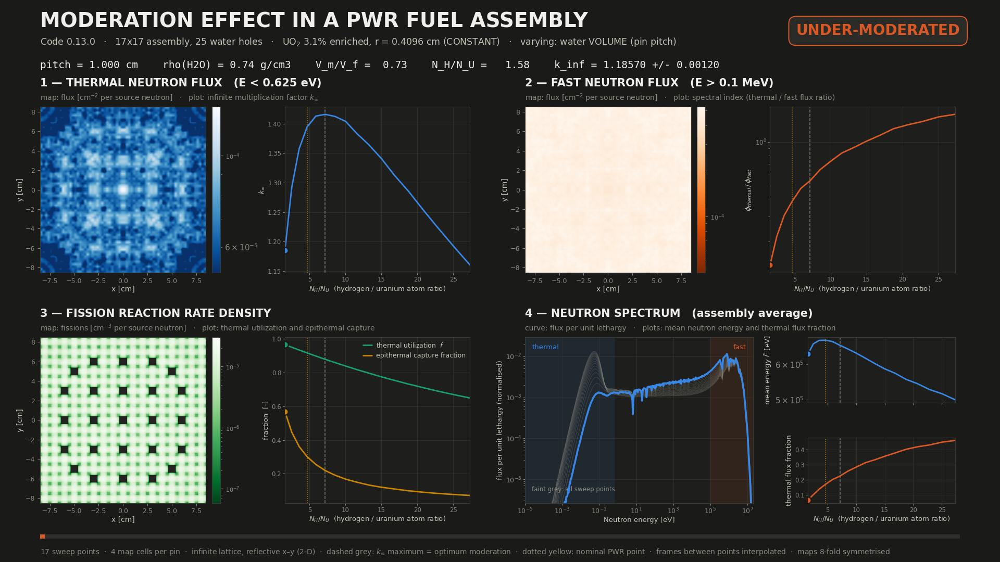
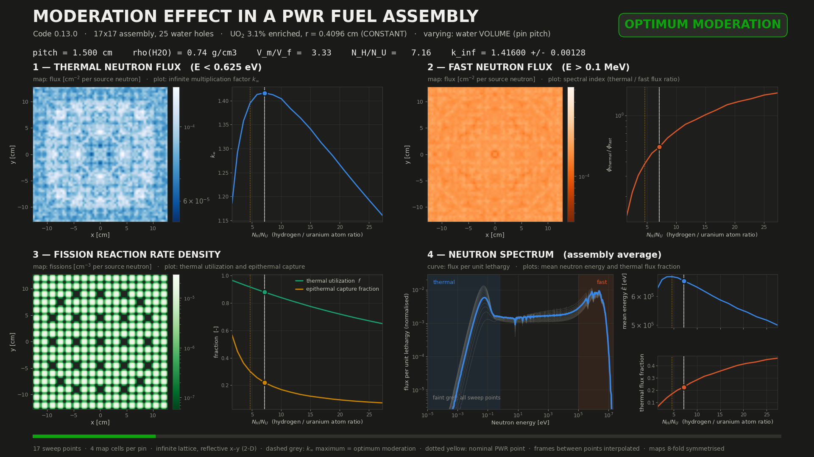
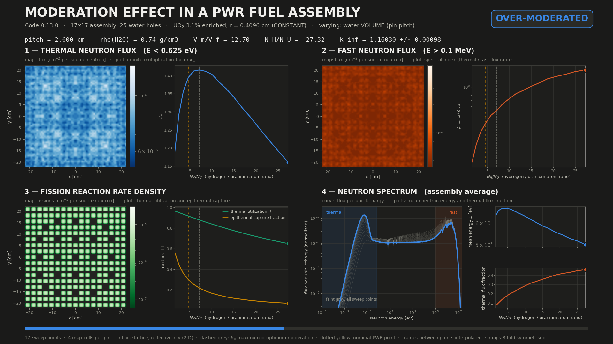

# OpenMC-PWR-Moderation-Study
OpenMC-based parametric study of neutron moderation effects in a 17×17 PWR fuel assembly. Investigates the effects of moderator volume (pin pitch) and water density on neutron multiplication factor (k-inf), thermal and fast neutron flux distributions, fission reaction rates, neutron energy spectra, and moderation parameters (N_H/N_U and V_m/V_f).
# Moderation Conditions

